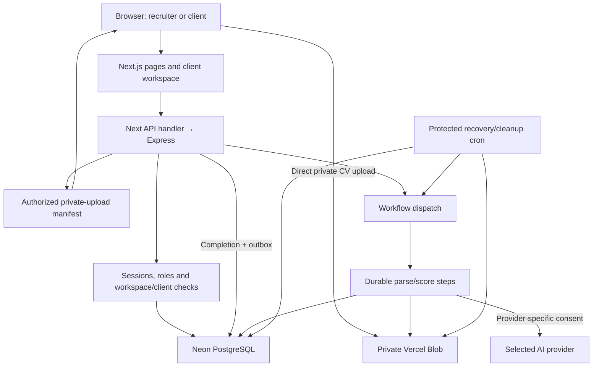
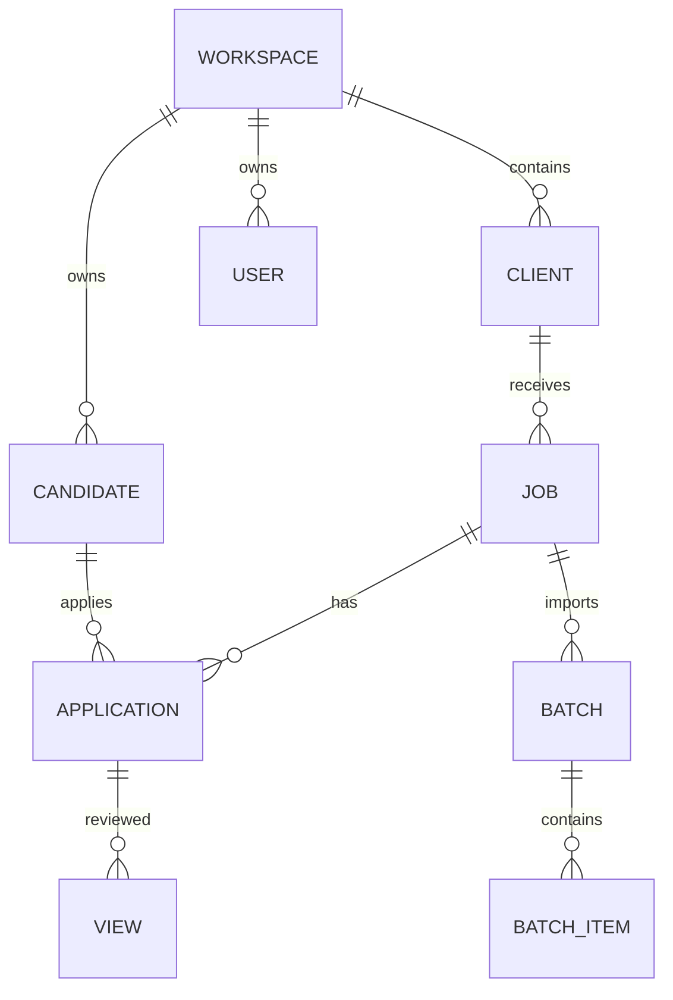

# Shortlist · IsoCode Labs

A staffing workflow for Company A: turn a JD and a batch of CVs into an evidence-backed shortlist, let the client review it, and track candidates through joining.

[Live app](https://isocode-pied.vercel.app) · [Sign in](https://isocode-pied.vercel.app/login) · [GitHub](https://github.com/niteshsaini9568/ISOCODE-Assignment) · [Small test pack](https://isocode-pied.vercel.app/demo/shortlist-manual-test-kit.zip)

## Quick user manual

Allow about 20 minutes for the sample flow. Use fictional CVs in shared demonstrations. Hosted reviewer logins are in the private submission's `deployment.md`; local seeded logins appear under [Local development](#local-development).

### Recruiter

1. **Sign in or create a workspace.** A new signup creates a private recruiter workspace. Use a separate workspace for a private AI test rather than sharing your key's usage with other demo reviewers.
2. **Connect AI.** Choose OpenAI, Gemini or Groq, keep its suggested model or enter a compatible one, and save your API key. A small verification request checks a new key before saving. Recruiter dashboard access requires a configured provider; clients do not need a key.
3. **Add a client.** Open **Trust & review → Clients & access**, enter a fictional client name and click **Add client**.
4. **Create a scorecard.** Open **JD scorecard → Create new**, select the client, paste `JD.txt` from the test pack and click **Extract scorecard**. Check the skills, experience, notice, location, weights and must-have flags before saving. Do not invent missing CTC.
5. **Upload CVs.** In **CV inbox**, select the three files from `01-upload-first`. Record a consent reference, hiring-use permission and permission for the selected AI provider when used. Click **Parse CVs** and inspect each file's status.
6. **Review the evidence.** Open **Candidate ranking**, inspect supporting quotations and missing facts, and search lower-scoring profiles. Upload the file in `02-duplicate-check` separately: it should reuse the existing profile instead of creating a fourth unique candidate.
7. **Open and submit.** Open a candidate drawer, click **Open original CV**, inspect the file and then **Submit to client**. Opening the drawer alone does not satisfy the original-CV view gate. Submit two profiles and leave one unsubmitted.
8. **Invite a client user.** Create an invitation for another email in **Clients & access**. Open its private link in incognito or another browser. The invited account must use that email. Share the link manually; no invitation email is sent.
9. **Follow progress.** Client decisions appear in **Hiring pipeline**. Record Offered and Joined when appropriate. Use **Trust & review** for consent, access events, the weekly rank/recruiter comparison and deletion of fictional test candidates.

### Client hiring manager

1. Sign in with the supplied client login, or join through an invitation link.
2. Open **Your shortlists** and select a requisition. Only profiles submitted to your client account should appear; unsubmitted profiles must stay hidden.
3. Use **Read full evidence** to inspect masked job facts and supporting lines. Clients cannot download original recruiter CVs.
4. **Shortlist**, **Reject** with a job-related reason, or propose a future **Interview** time. Empty reasons are blocked. Interview slots are proposals, not emails or calendar bookings.
5. Check **Hiring pipeline** for shared progress. A stale scorecard/submission needs recruiter review and resubmission before another client decision.

### Sample facts

| Candidate | Experience | Key skills | Notice | Expected evidence against the Java JD |
| --- | ---: | --- | ---: | --- |
| Ritika Bansal | 6.5 years | Java, Spring Boot, microservices | 60 days | Strongest fit among these three |
| Pooja Nair | 4 years | Java, Hibernate, REST APIs | 90 days | Experience/notice gaps; Spring Boot not stated |
| Arjun Rawat | 3 years | KYC, AML checks, Excel | 30 days | Notice fits; Java skills and experience do not |

Example JD: **Senior Java Developer, 5–8 years, Java, Spring Boot, Noida, notice up to 60 days**. CV location and CTC are not stated and must remain unknown. Imported IDs may differ from assignment IDs. Exact AI scores can vary; compare evidence instead of expecting a fixed number.

The hosted reviewer sandbox has three fictional profiles and two client submissions. Preloaded scores are labeled **demo rules**, not paid-model output. Reviewers supply their own key for fresh AI extraction/scoring; use a new requisition and fresh consented uploads for that path. The pack's [complete manual checklist](sample-data/manual-test-kit/README.md) covers review gates, decisions, pipeline, access records and deletion.

## Technical documentation

- [Scope and assumptions](#scope-and-assumptions)
- [Architecture](#architecture)
- [Repository structure](#repository-structure)
- [Data model](#data-model)
- [Authentication and authorization](#authentication-and-authorization)
- [CV processing and recovery](#cv-processing-and-recovery)
- [AI scoring and evidence](#ai-scoring-and-evidence)
- [Consent deletion and fairness](#consent-deletion-and-fairness)
- [Frontend and navigation](#frontend-and-navigation)
- [API reference](#api-reference)
- [Local development](#local-development)
- [Configuration](#configuration)
- [Vercel deployment](#vercel-deployment)
- [Testing and verification](#testing-and-verification)
- [Troubleshooting](#troubleshooting)
- [Limits and next work](#limits-and-next-work)
- [Design provenance and related documents](#design-provenance-and-related-documents)

## Scope and assumptions

The core is JD intake → bulk parsing → ranked evidence → recruiter approval → client review → pipeline. The two roles are **recruiter** and **client hiring manager**. A separate delivery-head/executive role is not implemented; recruiters can access weekly review.

Company A's staffing, revenue, hiring volumes, approximately ₹1.57 crore annual cost/lost-fee estimate, ₹7 lakh budget and six-week delivery horizon are supplied brief assumptions. The application does not claim measured savings or achievement of the hiring targets.

Implementation choices and assumptions:

- A workspace provides the recruiting-company boundary and contains clients/requisitions.
- CTC is annual INR lakh, experience is years and notice is days.
- Capacity is 500 files subject to **8 MB per file and 100 MB combined**. The byte limits are engineering safeguards, not client-supplied numbers.
- Extra local requisitions, client names, demonstration accounts and consent records are fictional setup data, not real candidate consent.
- Provider choices/defaults, bring-your-own-key setup and hosting services are implementation decisions.
- Invitations are manually shared links; interviews are in-app proposals. No calendar delivery or invitation mailing is implied.

Job-board integration/scraping, video interviews and background verification are out of scope. No payments workflow is built.

## Architecture

**Frontend:** Next.js App Router and React. **Backend:** Node.js and Express, invoked through a Next API handler. The app does not depend on CampusHire's other services or accounts.



| Choice | Reason and tradeoff |
| --- | --- |
| Next.js pages and client workspace | Dedicated public/authentication pages, protected direct entry and fast internal navigation without recreating the dashboard. |
| Express inside the Next API handler | One implementation of validation, authorization and business rules; cloud operation needs no custom listening server. |
| PostgreSQL | Durable records, sessions, shared rate limits, queue state and transactions across function instances. |
| Private Blob with direct uploads | CVs remain private and large file bodies bypass function payload limits. |
| Workflows and durable outbox | Processing survives a single request and can resume interrupted work; work is recorded before dispatch. |
| SQLite/local files | A small local demo works without cloud resources. This is not the hosted persistence strategy. |

### Runtime boundaries

[server/runtime.js](server/runtime.js) chooses local/cloud operation. Vercel requires durable cloud configuration and does not silently fall back to temporary SQLite. [The API handler](src/pages/api/%5B...path%5D.js) runs Express, waits for database cleanup and gives dispatch a background execution lifetime.

[server/postgres.js](server/postgres.js) pins a connection per request context, serializes queries and releases transactions/locks on exit. Workspace mutations use session-level advisory locks: **use a direct PostgreSQL URL**, not a transaction pooler. `DATABASE_URL_UNPOOLED` takes precedence; known pooled URLs are rejected. Small per-instance pools do not establish a global connection cap; load testing is still needed.

PDF loading is deferred until parsing is required. Function tracing explicitly includes native canvas files and the PDF worker so PDF dependencies do not crash unrelated API/authentication startup.

## Repository structure

```text
src/
  app/                     Public, authentication, provider and dashboard pages
  pages/api/[...path].js   Next handler hosting Express
  App.jsx                  Recruiter/client workspace and screens
  components/              Navigation, auth, provider setup and UI components
  upload-cvs.js            Multipart or direct-to-Blob upload flow
  api-pages.js             Collection pagination helpers
server/
  app.js                   Endpoints, access checks and workflow rules
  auth.js                  Accounts, sessions, invitations and Google OAuth
  ai.js                    Provider requests, extraction and scoring
  domain.js                Schemas, identity filtering and evidence validation
  parser.js                PDF/DOCX text and scan/transcript path
  worker.js                Import and scoring work
  credentials.js           Workspace/provider-bound AES-GCM key storage
  postgres.js              Adapter, request contexts and locks
  postgres-schema.sql      Repeatable cloud schema
  db.js                    Local SQLite schema and access
  cloud-uploads.js          Manifests, authorization and cleanup
  files.js                 Local/Blob files and signed downloads
  dispatch.js              Outbox dispatch
  rate-store.js            Shared PostgreSQL authentication limits
  mail.js                  Optional Resend reset-email adapter
  seed.js                  Local fictional demonstration data
workflows/hiring.js         Durable processing workflow and step
scripts/                   Migration, preflight, samples and verification
tests/                     Domain, HTTP, parser, privacy and cloud fixtures
sample-data/               Fictional CVs, JD and manual test kit
public/                    Fonts, brand resources and public test-pack ZIP
docs/                      Design, deployment, verification and licenses
```

## Data model

See [the cloud schema](server/postgres-schema.sql). Profile, criteria, score and consent structures are serialized JSON in text columns. Ownership is checked in the application; PostgreSQL row-level-security policies are not claimed.

| Entity | Responsibility |
| --- | --- |
| `workspaces`, `clients` | Recruiting-company boundary and its client accounts. |
| `users`, `sessions` | Workspace/role/client binding, salted password hash, hashed session token and expiry. |
| `jobs` | Client/workspace, title, JD, location, criteria, scorecard version and mode. |
| `candidates` | Workspace, source text, profile, consent, private file path and deduplication hashes. |
| `applications` | Unique candidate–job pair; stage, score/version, submission/version, reason and proposed interview time. |
| `views`, `audit` | Versioned original-CV view; actor/action/subject/detail/time for access and decisions. |
| `upload_sessions`, `upload_files` | Manifest, actor/job/workspace, expiry, size/type and private object path. |
| `batches`, `batch_items` | Persistent import progress/errors and candidate links. |
| `settings`, `ai_credentials` | Selected provider/model and encrypted per-workspace/provider keys. |
| `workflow_outbox` | Requested work, dispatch time and Workflow run reference. |
| `weekly_reviews` | Saved rank/recruiter-choice sample, notes and timestamps. |
| Supporting records | Google identities/OAuth state, invitations, reset tokens and authentication rate limits. |



The diagram shows logical relationships; the SQL defines exact foreign-key constraints.

### Invariants

- A candidate and job must share a workspace before attachment. A client must own the job's client account and the application must be submitted before that client can read it.
- Scores and original-CV review approval belong to a scorecard version. Scorecard/transcript changes invalidate approval. Stale submissions cannot receive new client decisions until reviewed/resubmitted.
- Submission requires a current original-CV view, a current score and recruiter approval.
- A candidate–job pair has one application. Duplicates reuse profiles; similar names alone do not merge people.

## Authentication and authorization

Signup creates a private recruiter workspace and an initial client. Client roles come from single-use invitations bound to workspace, client and email, expiring after seven days. Signup cannot select its own privileged role or another workspace.

Passwords use salted scrypt. Random session tokens are hashed in storage and expire after eight hours. Cookies are HttpOnly and SameSite=Lax, with Secure on HTTPS origins. PostgreSQL authentication limits are shared across API instances. Mutation checks reject cross-site requests and validate supplied origins.

Direct protected page entries validate session/provider setup on the server. Each API separately checks authentication, role and ownership. Client-side navigation does not grant permissions.

Google OAuth uses authorization code flow, PKCE, browser-bound state, nonce and verified ID tokens. Matching email addresses are not automatically linked to password accounts. Register the callback on the configured OAuth client:

```text
Local:  http://127.0.0.1:5173/api/auth/google/callback
Hosted: https://isocode-pied.vercel.app/api/auth/google/callback
```

Reset tokens expire after 30 minutes, are single-use and revoke sessions when used. Local demo recovery can show a test link. Hosted reset delivery needs a valid Resend sender/key and has not been live verified. Client invitation mailing is mocked; use the generated link.

## CV processing and recovery

### Upload lifecycle

1. The recruiter selects a job and records consent.
2. Cloud mode creates an authenticated, workspace-scoped manifest with authorized private paths, exact sizes, MIME types and expiry.
3. The browser uploads directly to Blob, with up to four uploads in flight. Only recruiters can obtain tokens. The SDK validates completion callback signatures.
4. Completion verifies object metadata, then commits batch items and an outbox request before acknowledging work.
5. A Workflow processes imports and scores. The UI reads persistent status; closing the browser does not own or cancel server work.
6. Local mode uses multipart upload, local files and the local worker instead.

| Boundary | Limit or behavior |
| --- | --- |
| Batch | Up to 500 PDF/DOCX files, subject to 100 MB combined. |
| File | At most 8 MB; extension and leading file signature checked. |
| DOCX | Mammoth reads paragraphs/tables; malformed archives rejected; expansion bounded at 32 MB. |
| Text | At most 100,000 extracted characters. |
| Text-poor PDF | Transcript verification rather than an assumed successful score. |
| Duplicate | Workspace-scoped byte hash, normalized text and available email. |

Import states include `pending`, `processing`, `done`, `duplicate`, `needs_review`, `failed` and `deleted`. Per-file failures remain visible and retryable.

[workflows/hiring.js](workflows/hiring.js) processes durable steps under a workspace lock. Replay returns interrupted processing to the pending path. Transactions and uniqueness checks protect candidate/application creation. [server/dispatch.js](server/dispatch.js) dispatches outbox work.

The protected cron recovers work and cleans abandoned uploads/duplicate objects. Its configured fallback runs daily at **03:00 UTC**; normal completion dispatches immediately. This is not a recovery-time SLA. Candidate erasure removes retained duplicate Blob paths before manifests, rather than depending on later cleanup.

## AI scoring and evidence

### Providers and keys

| Provider | Code default | Path |
| --- | --- | --- |
| OpenAI | `gpt-4.1-mini` | JD/fact extraction, evidence scoring and consented PDF transcription. |
| Gemini | `gemini-2.5-flash` | JD/fact extraction, evidence scoring and consented PDF transcription. |
| Groq | `openai/gpt-oss-120b` | Text extraction/scoring; scans need a verified transcript. |

These are editable defaults in [server/ai.js](server/ai.js), not a model benchmark. The model must be available/compatible with the provider account. A new key receives a small check without CV data; failed validation preserves previous settings.

Keys use AES-256-GCM with a fresh nonce and workspace/provider authenticated data. Cloud mode uses the stable `CREDENTIALS_ENCRYPTION_KEY`; local mode can use ignored `DATA_DIR/credentials.key`. Losing/changing the master key can make saved keys unreadable. Plaintext keys are not returned by settings/config APIs or stored in scores/audits. A workspace key overrides an optional server fallback. No shared paid key is supplied in the reviewer deployment.

Provider changes are blocked during active processing. New work/explicit retries use the current selection; existing score metadata retains its original provider/model.

### Evidence contract

1. Validate criterion kinds, unique IDs, numeric bounds, weights and exclusion of personal-trait criteria.
2. Produce numbered job-relevant source lines, filtering name/contact/protected-trait lines from the scoring boundary.
3. Request every criterion exactly once with `met`, `partial`, `not_met` or `unknown`, plus line/quote evidence.
4. Reject missing/duplicate/unknown IDs. Every non-unknown result needs evidence; quotes must be exact substrings of referenced source lines.
5. Calculate the total on the server rather than trusting an AI-supplied score:

```text
credit(met) = 1
credit(partial) = 0.5
credit(not_met or unknown) = 0
score = round(100 × sum(weight × credit) / sum(weight))
```

A must-have flag highlights a requirement; it never automatically rejects someone. A quotation establishes source support, not the truth of a CV or every model judgment. Human review remains required.

### Uncertainty scans and failure behavior

- Missing facts stay unknown. Extracted skills/numbers are checked against source text; unsupported values are filtered or fall back to explicitly extracted facts.
- Permission is provider-specific. Changing providers does not transfer consent automatically.
- Consented OCR may send the original PDF to that provider; this differs from filtered scoring input. The recruiter verifies the transcript before scoring.
- Invalid output/provider errors remain visible and retryable; they do not silently become successful AI results.
- Without an enabled provider, the scoring service can generate explicitly labeled **demo-rule scores**. Preloaded reviewer data uses this mode; it does not establish paid-model accuracy.

## Consent deletion and fairness

Consent includes purpose, source, time, recorder and provider permission. Hiring use is the intended purpose; views/submissions/decisions are audited.

Deletion requires the exact candidate ID. Active imports block it to prevent re-creation. Erasure removes original and retained duplicate CV objects, profiles, applications, views and related saved weekly samples. Import metadata is cleared/replaced; a generic deletion event remains. Storage failures are returned rather than falsely acknowledged.

Weekly review compares ranks with recruiter submission choices using up to 30 candidate–job pairs from the previous seven days. Notes/snapshots can be saved. This is an audit aid, not demographic parity analysis or fairness certification.

Identity filtering is heuristic and needs broader language/layout evaluation. These mechanisms do not certify DPDP compliance. Retention, backup erasure, provider agreements and operational/legal review remain rollout work.

## Frontend and navigation

Core screens are overview, editable scorecard, CV inbox, ranking/evidence drawer, pipeline, client shortlist and trust/review. Home, authentication and provider setup are separate entry screens.

The dashboard uses charcoal surfaces, Inter, neutral borders, white primary actions and restrained status colors. The animated mosaic homepage is separately scoped. Charts show current role-scoped application counts, not invented revenue/history. A candidate applying to two jobs counts as two applications.

Panels stack on phones. The mobile drawer supports focus handling, Escape and focus restoration. Forms have labels; dialogs, empty lists, pending processing, stale submissions and errors expose a next step.

Internal sections/requisition changes use native History API updates with Next.js URL hooks. The workspace stays mounted; Back/Forward works without repeated startup requests. Direct refresh still performs normal server authentication. Sections may fetch their own data; this does not promise that every unsaved form survives leaving its screen.

## API reference

Responses are JSON except authorized file/redirect responses. The server checks role/ownership independently of UI visibility. Detailed evidence comes from the application endpoint; cloud collection responses omit bulky quotations. `:id` denotes a scoped resource identifier.

| Method | Endpoint | Purpose |
| --- | --- | --- |
| GET | `/api/health`, `/api/config` | Database health and public-safe configuration. |
| POST | `/api/auth/signup`, `/api/auth/login` | Workspace/invited signup and email sign-in. |
| GET / POST | `/api/auth/me` / `/api/auth/logout` | Read account / revoke session. |
| GET | `/api/auth/invitation` | Validate invitation details. |
| POST | `/api/auth/forgot-password`, `/api/auth/reset-password` | Request/use a reset link. |
| GET | `/api/auth/google`, `/api/auth/google/callback` | OAuth start/callback. |
| GET / POST | `/api/clients` | Read scoped clients / recruiter creates one. |
| POST | `/api/invitations` | Recruiter creates an email-bound client invitation. |
| GET / POST | `/api/jobs` | Read scoped jobs / recruiter creates one. |
| POST | `/api/scorecard/extract` | Recruiter extracts requirements. |
| PUT | `/api/jobs/:id/scorecard` | Save/version the scorecard. |
| GET | `/api/jobs/:id/candidates` | Scoped, paginated application collection. |
| GET | `/api/applications/:id` | Detailed profile, criteria and evidence; audited access. |
| GET | `/api/applications/:id/cv` | Recruiter original access and versioned view record. |
| POST | `/api/applications/:id/submit` | Submit after current review/scoring gates. |
| POST | `/api/applications/:id/decision` | Client shortlist/reasoned rejection/interview. |
| PATCH | `/api/applications/:id/stage` | Recruiter pipeline update. |
| POST | `/api/applications/:id/retry` | Requeue score work. |
| POST | `/api/jobs/:id/upload-session` | Cloud manifest and consent. |
| POST | `/api/blob/upload` | Recruiter token or SDK-validated callback. |
| POST / DELETE | `/api/upload-sessions/:id/complete` / `/api/upload-sessions/:id` | Queue verified uploads / abandon an unfinished session. |
| POST | `/api/jobs/:id/upload` | Local multipart path. |
| GET | `/api/jobs/:id/batches` | Paginated batch/file status. |
| GET | `/api/batch-items/:id/review`, `/api/batch-items/:id/cv` | Recruiter transcript/original review. |
| POST | `/api/batch-items/:id/transcript`, `/api/batch-items/:id/retry` | Verify transcript / retry a failed import. |
| GET / PUT | `/api/settings/ai` | Read safe settings / validate and save provider/key. |
| GET | `/api/privacy` | Recruiter consent and access records. |
| PUT / DELETE | `/api/candidates/:id/consent` / `/api/candidates/:id` | Update consent / confirm erasure. |
| GET / POST | `/api/weekly-review` | Read sample/reviews / save a snapshot. |
| GET | `/api/cron/workflows` | Secret-authorized cloud recovery/cleanup. |

Collections use offset pagination. Frontend helpers gather required pages so later/low-scoring candidates are not hidden behind the first response. Resource limits are in [server/app.js](server/app.js) and [src/api-pages.js](src/api-pages.js).

## Local development

Requires **Node.js 24.x** and npm. For a fresh SQLite demonstration:

```powershell
git clone https://github.com/niteshsaini9568/ISOCODE-Assignment.git
cd ISOCODE-Assignment
npm.cmd ci
New-Item .env -ItemType File
npm.cmd run seed
npm.cmd run samples
npm.cmd run dev
```

Open [http://127.0.0.1:5173](http://127.0.0.1:5173). If `.env` exists, edit rather than overwrite it. An empty fresh local environment uses development defaults. Leave cloud database variables absent for SQLite; otherwise PostgreSQL is intentionally selected. A fresh development start can also seed automatically.

| Local role | Email | Password |
| --- | --- | --- |
| Recruiter | `recruiter@company-a.test` | `Demo@12345` |
| Northstar client | `client@northstar.test` | `Demo@12345` |
| Meridian client | `client@meridian.test` | `Demo@12345` |

These are local synthetic logins, not hosted credentials. Recruiter onboarding still needs a real key for live AI. Clients can inspect seeded rule scores without one. Seeded originals can be synthetic text; uploads retain actual PDF/DOCX files.

`npm.cmd start` uses a production build and does not implicitly enable local demo accounts. To test a production build with the fictional SQLite database, explicitly enable local demonstration using `DEMO_MODE` in your ignored configuration and keep cloud database variables absent. Never seed a production configuration.

### Commands

| Command | Purpose |
| --- | --- |
| `npm.cmd ci` | Locked dependency installation. |
| `npm.cmd run dev` | Next development server on port 5173. |
| `npm.cmd run build` | Optimized Next/Workflow build. |
| `npm.cmd start` | Start the existing production build on port 5173. |
| `npm.cmd test` | Domain, HTTP, parser, privacy and integration tests. |
| `npm.cmd run seed` | Idempotent local seed, blocked outside demonstration mode. |
| `npm.cmd run samples` | Three PDF and three DOCX samples plus JD. |
| `npm.cmd run migrate:cloud` | Repeatable PostgreSQL schema migration. |
| `npm.cmd run check:cloud` | Cloud configuration/schema preflight. |
| `npm.cmd run test:runtime` | Compiled Next/Node/Workflow checks with isolated PostgreSQL. |
| `node scripts/verify-public-routes.js` | Route checks with deliberately missing cloud configuration. |

## Configuration

Put actual values only in Vercel or ignored `.env` / `.env.local` files. Do not commit infrastructure keys, real CVs or `data/`. Names and purposes:

| Variable | Purpose |
| --- | --- |
| `APP_URL` | Exact app origin for OAuth/links; HTTPS when hosted. |
| `DEMO_MODE` | Explicit synthetic local demo control; disable in cloud mode. |
| `DATABASE_URL` | Direct PostgreSQL URL unless overridden. |
| `DATABASE_URL_UNPOOLED` | Preferred direct override for a pooled integration default. |
| `BLOB_READ_WRITE_TOKEN` | Private Blob server authorization. |
| `CREDENTIALS_ENCRYPTION_KEY` | Stable 32-byte master key as 64 hexadecimal characters. |
| `CRON_SECRET` | Recovery authorization, at least 32 characters. |
| `GOOGLE_CLIENT_ID`, `GOOGLE_CLIENT_SECRET` | Optional Google OAuth pair. |
| `RESEND_API_KEY`, `MAIL_FROM` | Optional reset-email adapter. |
| `AI_PROVIDER` | Optional initial provider. |
| `OPENAI_API_KEY`, `GEMINI_API_KEY`, `GROQ_API_KEY` | Optional server fallbacks; hosted reviewer flow uses workspace keys. |
| `OPENAI_MODEL`, `GEMINI_MODEL`, `GROQ_MODEL` | Defaults before saved workspace selection. |
| `DATA_DIR` | Local database/upload/key directory. |
| `TEST_DATABASE_URL` | Isolated direct PostgreSQL test database. |

Integrations supply their own Vercel/Blob/Workflow helper variables. Retain database TLS options. Changing the encryption master key can make saved provider keys unreadable. Preflight validates configuration/schema, not live AI quality, email delivery or completed OAuth.

## Vercel deployment

1. Keep the assessment repository public during review and retain history. Import this standalone repository with its root as the project directory and **Next.js** as framework. Node.js 24 is declared in `package.json`.
2. Connect Neon PostgreSQL and a **private** Blob store. Use a direct URL for session locks. Migration does not copy local SQLite data.
3. Configure the intended deployment environment with the names above. Register the exact hosted Google callback on the configured OAuth client.
4. [vercel.json](vercel.json) installs with `npm ci`, then runs `npm run migrate:cloud && npm run check:cloud && npm run build`. Migrations do not create cloud demo accounts.
5. Deploy, confirm successful JSON from `/api/health` and `/api/config`, and check unauthenticated dashboard redirection.
6. Verify a small private upload and completed Workflow before a large batch. Daily recovery/cleanup is a fallback; shorter schedules need a suitable plan and separately chosen configuration.

Equivalent preflight with your own ignored cloud configuration:

```powershell
npm.cmd ci
npm.cmd run migrate:cloud
npm.cmd run check:cloud
npm.cmd run build
```

Do not configure `server/index.js` as a listening Vercel server; that launcher is legacy/local. See [the deployment guide](docs/vercel-deployment.md). Deployment exclusions keep env files, test data and source archives out; the public fictional test ZIP has an explicit exception.

## Testing and verification

Recorded on **7 November 2026**; [the final verification record](docs/submission-verification.md) distinguishes fixtures from hosted services.

| Evidence | Result |
| --- | --- |
| Isolated PostgreSQL 18 full suite | **63 passed, zero failures/skips**. Without `TEST_DATABASE_URL`, four PostgreSQL cases skip. |
| Production build | Passed. |
| Compiled local runtime/Workflow | **18 checks passed**, Workflow completed. |
| Hosted fictional-data flow | **17 checks passed**, including private storage, parsing Workflows, client controls and original/duplicate Blob erasure. |
| Production-build browser navigation | Sections, job selection, Back/Forward, create state and refresh passed; zero document/RSC/session-startup requests during internal navigation. |
| Repository checks | Public/history verified; no configured-secret/key-pattern matches in scanned history/archives. Not a security certification. |

Tests cover actual 500-file fixtures, Unicode names, malformed archives, size/text limits, scans, duplicates, consent, fabricated evidence, workspace/client isolation, stale submissions, authentication, encrypted-key transplant rejection, shared rate limits, interrupted work and erasure.

Configure your own isolated direct `TEST_DATABASE_URL`, then run `npm.cmd test`. Cases create unique `shortlist_test_…` schemas and drop only those schemas. Do not use real applicant data. Run `npm.cmd run test:runtime` for compiled checks. No extra test framework is needed.

Hosted tests used fictional profiles. The 500-file/concurrency/replay checks used isolated databases and controlled provider/storage responses; they do not establish 70-recruiter throughput. Paid AI, completed Google callback, representative scan OCR and email delivery remain separately unverified. A fresh client-mobile browser pass was not part of final packaging.

## Troubleshooting

| Symptom | Check |
| --- | --- |
| Configuration/database unavailable | Read runtime logs; check direct DB, migrations, encryption key, Blob and origin. Login-page rendering alone does not prove backend readiness. |
| Pooler error | Configure a direct URL; do not disable TLS or workspace locks to hide it. |
| Google `redirect_uri_mismatch` | Register the exact callback on the same OAuth client used by the deployment. |
| Key/scoring error | Check model access, quota, key and provider-specific candidate permission. An error is not a successful score. |
| Provider change/deletion blocked | Wait for active uploads/imports/scoring. Abandoned uploads expire and are cleaned through recovery. |
| Scan has no score | Compare/edit its transcript against the original, then verify before scoring. |
| Submit/decision blocked | Open the original and ensure score/review/submission versions match the current scorecard. Resubmit after changes. |
| Empty client portal | Check invited client account, job, filter and recruiter submission; unsubmitted profiles are intentionally hidden. |
| Local login fails | Check local demo mode/data directory; SQLite and hosted accounts are separate. |
| CV URL expired | Reopen through the authorized application action for a fresh short-lived URL. |
| Reset email missing | Verify the optional Resend sender/key; invitation links do not depend on reset-email delivery. |

## Limits and next work

The app implements the assignment slice and safeguards, not certified DPDP compliance. Before real use, evaluate multilingual/layout privacy filtering, representative CVs/scans, malware handling, provider agreements, retention/backup erasure, alerts, restores and concurrency.

Next: run consented real-provider accuracy checks, a recruiter/client pilot and connection/Workflow recovery load tests. No measured 60% screening reduction, 80% within-48-hour shortlists, 60% acceptance or financial saving is claimed. These brief targets need a comparable baseline and real pilot.

## Design provenance and related documents

The UI adapts components obtained through **21st.dev MCP**, including Dashboard Shell by isaiahbjork and File Dropzone by joyco, plus the MIT-licensed [ShadcnStore template](https://github.com/shadcnstore/shadcn-dashboard-landing-template). Supplied mosaic resources and fonts are scoped to the intended UI. Backend work used Ponytail guidance; Ponytail is a skill, not an MCP service. AI-assisted implementation/review was used.

- [Design system](docs/design-system.md), [template reference](docs/shadcnstore-reference.json), [licenses](docs/licenses).
- [Provider setup](docs/provider-setup.md).
- [Deployment guide](docs/vercel-deployment.md).
- [Final verification](docs/submission-verification.md). Older dated reports describe historical runs, not the latest hosted state.
- [Brief and measurement plan](docs/assignment.md).
- [Manual checklist](sample-data/manual-test-kit/README.md).

The assessment ZIP contains exactly the TDD PDF and `deployment.md`. This public README supplements those files. Hosted reviewer passwords remain only in the private deployment document.
