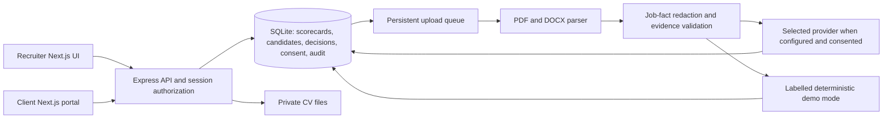

# Company A assignment: scope and delivery notes

## The business case

The brief assumes 300 requisitions × 120 CVs × 3 minutes = **108,000 minutes**, or **1,800 hours per month**. At 12 months × ₹350/hour that is **₹75.6 lakh/year**. Lost requisitions: 3,600/year × 5% × ₹45,000 = **₹81 lakh/year**. Together: **₹156.6 lakh, rounded to ₹1.57 crore/year**.

These are scenario assumptions, not audited losses. A 60% reduction in screening time would represent 1,080 hours/month or ₹45.36 lakh/year in released screening capacity at the stated rate, not automatically a cash saving. Track lost-fee recovery separately to avoid claiming every lost requisition will be recovered.

## Acceptance coverage

| Requirement | Implementation |
| --- | --- |
| JD intake | Extract, edit, add/remove/reweight criteria and save versioned scorecards; Provider/model selector, AI optional, labelled demo mode when the selected key is absent |
| PDF/DOCX bulk upload to 500 | Streamed private storage, per-file validation and progress, persistent queue, paragraph/table extraction, duplicate fingerprints, recovery and transcript review |
| AI scores with evidence | OpenAI/Gemini/Groq adapters; all criteria and quotes validated; scores calculated on server; visible demo rule mode without credentials |
| Client shortlist portal | Server-scoped by client and submission; masked contact data; shortlist, reject with reason and propose future interview |
| Pipeline | Sourced, reviewed, submitted, shortlisted, interview, offered, joined and human rejection |
| Consent and deletion | Hiring/AI consent source records, access log, ID-confirmed erasure across requisitions |
| Human control | No auto-rejection; opening the CV enforced before submission; low scorers searchable; version-specific review |
| Fair-treatment review | Seven-day rank/choice sample and saved review notes; no unsupported demographic fairness claim |

Core roles are recruiter and client hiring manager. The weekly review is accessible to recruiters as the delivery-head handoff; a separate delivery-head login is not implemented. Client accounts and two extra demonstration JDs are illustrative. Only the three supplied candidate records are seeded.

## Architecture

## Six-week plan within ₹7 lakh

This allocation is a planning proposal, not a supplier quote. It assumes an existing deployment account, no enterprise SSO or external ATS integration, and modest initial provider usage.

| Week | Work and exit condition | Allocation |
| --- | --- | ---: |
| 1 | Confirm scorecards, data permissions, recruiter/client screens and measurement baseline | ₹0.75 lakh |
| 2 | Intake, private CV storage, format/scan fixtures and duplicate handling | ₹1.25 lakh |
| 3 | Model prompts, consent-aware processing, evidence validation and parsing evaluation | ₹1.25 lakh |
| 4 | Ranked review, client decisions and shared pipeline with authorization checks | ₹1.25 lakh |
| 5 | Mobile UX, erasure/retention work, security review and concurrent-user tests | ₹1.00 lakh |
| 6 | Recruiter pilot, provider evaluation, training, rollout and corrections | ₹0.75 lakh |
| Reserve | Initial hosting/provider spend and contingency | ₹0.75 lakh |
| Total | | **₹7.00 lakh** |

This repository ships the local assignment slice. Production controls and pilot validation listed in the README remain work for the proposed delivery period.

## Measuring success

- **Screening time:** instrument active review sessions and compare median recruiter minutes per requisition against a comparable baseline. Target 60% reduction. Do not substitute faster API calls for recruiter time saved.
- **Shortlist turnaround:** measure first submitted shortlist timestamp minus approved requisition timestamp; target at least 80% within 48 hours. The local app retains creation and submission timestamps, but does not claim a measured SLA.
- **Client acceptance:** define accepted as human client shortlist/interview approval, with distinct candidate–requisition pairs and a fixed period. Compare to the stated 45% baseline; target 60%. A small demo sample is not evidence of improvement.
- **Weekly review:** examine disagreements between rank and recruiter choice, missing evidence and parsing errors. Record corrections and evaluate on a held-out sample before changing prompts or weights. Protected-trait outcome analysis would need a separately authorized methodology and suitable consent; this app does not collect those traits for that purpose.

## Verification

`npm test` covers domain evidence validation and an actual local HTTP workflow with 500 uploaded PDF files, cross-format duplicates, PDF/table-based DOCX parsing, scan review, access isolation, scorecard invalidation, client decisions and file/database erasure. `npm run build` verifies the production frontend compiles. Browser QA is recorded in `docs/verification.md`.
